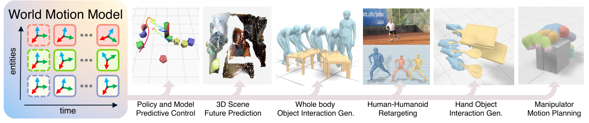

# World Motion Models: Flexible Sequence Modeling of SE(3) Trajectories

Code, data and checkpoints for the NeurIPS 2026 paper *World Motion Models* (Jiahui Lei, Qianqian Wang, Trevor Darrell, Angjoo Kanazawa).



Project page: <https://jiahuilei.com/projects/wmm>

**This repo is cleaned and re-organized by coding agents from the internal implementation**


## What is in this repository

| # | Path | Contents |
|---:|---|---|
| 1 | `apps/langtable/` | Language-Table manipulation: plain and MPC rollouts (paper Tables 1 and 2) |
| 2 | `apps/tracegen/` | Trace generation on Droid and EpicKitchen, compared with TraceGen |
| 3 | `apps/omomo/` | Human–object interaction synthesis on OMOMO, compared with CHOIS |
| 4 | `apps/retargeting/` | Humanoid motion retargeting (clean, in-fill and noisy inputs) |
| 5 | `assets/` | Figures used by this README |

Each application folder is self-contained: its README lists the environment, the data to download, and the commands for every reproduction level.

## Reproduction levels

| # | Level | What you do | Needs |
|---:|---|---|---|
| 1 | L1 | Recompute the paper tables from the raw evaluation outputs we release | CPU, minutes |
| 2 | L2 | Run inference with the released paper checkpoints and score it | One GPU, hours |
| 3 | L3 | Train from scratch, then evaluate as in L2 | GPUs, one to two days per model |

| # | Application | Paper result | Guide |
|---:|---|---|---|
| 1 | Language-Table | Tables 1 and 2 | [apps/langtable](apps/langtable/README.md) |
| 2 | TraceGen comparison | Trace generation table | [apps/tracegen](apps/tracegen/README.md) |
| 3 | OMOMO | Human–object interaction table | [apps/omomo](apps/omomo/README.md) |
| 4 | Retargeting | Humanoid retargeting table | [apps/retargeting](apps/retargeting/README.md) |

## Data and checkpoints

Released files are in the Google Drive folder [WMM release](https://drive.google.com/drive/folders/1oL3mB_9kxtKCI5OMNoUdVOFktnCMVTTZ). It holds tar archives per application and level, `MD5SUMS.txt` and the file list of every archive. Download the archives an application's README names, check them against `MD5SUMS.txt`, and extract them into `release_data/<app>/` at the repository root.

Some inputs cannot be redistributed and must be obtained under their own licences; each application's `prepare_data/` scripts then build the exact files the code reads:

| # | Source | Licence | Used by |
|---:|---|---|---|
| 1 | SMPL-X, SMPL-H body models | SMPL-X / SMPL-H model licences | OMOMO, Retargeting |
| 2 | AMASS | AMASS licence | Retargeting |
| 3 | OMOMO dataset | OMOMO licence | OMOMO |
| 4 | Embody3D | Embody3D licence | Retargeting |

Public third-party data and models (TraceGen datasets, DINOv3, T5, SigLIP, CHOIS and others) are fetched from their official sources by the download scripts in each application folder, which verify checksums.

## Licence

Code in this repository is released under the [MIT licence](LICENSE). Third-party code under `apps/*/code*/ext/` keeps its own licence. Released checkpoints and data follow the terms stated in the Drive folder's README.

## Citation

```bibtex
@inproceedings{lei2026wmm,
  title     = {World Motion Models: Flexible Sequence Modeling of SE(3) Trajectories},
  author    = {Lei, Jiahui and Wang, Qianqian and Darrell, Trevor and Kanazawa, Angjoo},
  booktitle = {Advances in Neural Information Processing Systems (NeurIPS)},
  year      = {2026}
}
```
