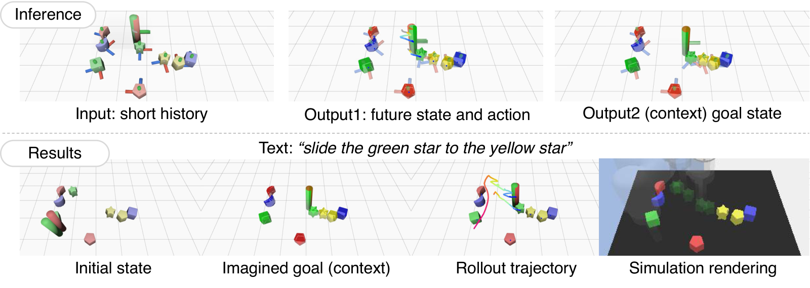
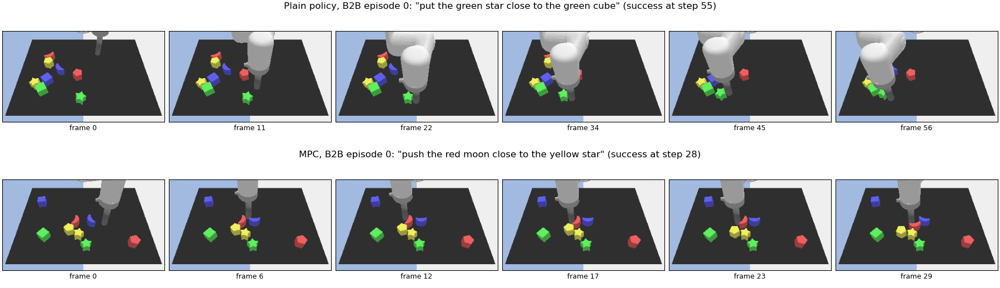

# Language Table: paper Tables 1 and 2



This folder reproduces the two Language Table tables of the paper at three levels:

| # | Layer | What you do | Needs | Time |
|---:|---|---|---|---|
| 1 | L1 | Recompute both tables from the released per-episode results | Python with pandas; 0.5 MB of data | seconds |
| 2 | L2 | Run the released checkpoint in the simulator again and rebuild the tables | Linux, NVIDIA GPU; 2.1 GB checkpoint + 1.1 GB public downloads | hours |
| 3 | L3 | Retrain the model from the released training data, then evaluate it as in L2 | 1 GPU with 48 GB; 313 GB of training data | about 2 days |

| # | Paper table | Question it answers |
|---:|---|---|
| 1 | Tab. 1 *Language Table* | How often does each method complete the instruction, per task family and on average? |
| 2 | Tab. 2 *Plain Policy versus MPC* | Does using WMM as a differentiable world model (MPC) make the same checkpoint succeed more often and faster than using it as a plain policy? |

## The experiment in plain words

[Language Table](https://github.com/google-research/language-table) (Lynch et al. 2022) is a simulated tabletop with 8 coloured blocks and a robot arm whose tip slides over the table. The robot receives a text instruction, for example *"put the green star close to the green cube"*, and has to push the blocks until a built-in rule says the instruction is fulfilled.

WMM drives the robot as a **policy**. Every 10 simulator steps it looks at the last 5 steps of every block's pose and of the robot tip, reads the instruction, and predicts how everything will move next, including where the robot tip should go. The robot executes the next 10 predicted tip positions, then WMM predicts again.

The evaluation follows the protocol of the public Language Table code (`language_table/eval/main.py`), also used by the LAPA and LCB papers:

| # | Setting | Value |
|---:|---|---|
| 1 | Task families | 5 (table below) |
| 2 | Episodes per family | 50 |
| 3 | Step limit per episode | 200 simulator steps; not finished by then = failure |
| 4 | Board | 8 blocks (`BLOCK_8`) |
| 5 | Simulator seed | 0 |
| 6 | Checkpoint | one WMM model trained on all five families together (training step 180,000) |

| # | Column | Task family | Example instruction |
|---:|---|---|---|
| 1 | B2B | block to block | put the green star close to the green cube |
| 2 | B2AL | block to absolute location | slide the blue cube to the center |
| 3 | B2BRL | block to block-relative location | slide the green star to the right of the green cube |
| 4 | B2RL | block to relative location | slide the blue cube upwards and then to the right |
| 5 | Sep | separate | separate the red moon from the blue moon |



## What the numbers mean

| # | Metric | Table | Meaning |
|---:|---|---|---|
| 1 | Success rate (%) | 1 and 2 | Successful episodes / 50 × 100 for one task family |
| 2 | Avg | 1 | Plain mean of the five family success rates |
| 3 | Mean / Med. / Min / Max steps | 2 | Number of simulator steps until the success rule fired, computed over **successful episodes only** (failures are left out). Lower = faster |

**Plain vs MPC (Table 2).** *Plain* executes the actions WMM predicts. *MPC* (model predictive control) first improves them: it builds 4 candidate 10-step action plans, runs WMM on each candidate without the instruction to predict where the blocks would end up, and adjusts the candidates by gradient descent (12 steps) so that this prediction approaches the goal scene WMM imagined from the instruction. The best candidate is executed. Both use the same checkpoint. Paper appendix *MPC details* has the full procedure.

Paper numbers (the notebooks hold them in `lt_tables.py`):

| # | Row | B2B | B2AL | B2BRL | B2RL | Sep | Avg |
|---:|---|---:|---:|---:|---:|---:|---:|
| 1 | WMM (Tab. 1) | 90 | 76 | 80 | 90 | 100 | 87.2 |
| 2 | LangTable orig. (Tab. 1, quoted from LCB) | 88 | 65 | 70 | 68 | 94 | 77.0 |

| # | Tab. 2 | Succ. | Mean steps | Med. steps | Min steps | Max steps |
|---:|---|---:|---:|---:|---:|---:|
| 1 | B2B Plain | 90.0 | 79.5 | 73.0 | 26 | 198 |
| 2 | B2B MPC | 100.0 | 79.1 | 68.5 | 16 | 175 |
| 3 | B2AL Plain | 76.0 | 92.7 | 87.0 | 14 | 187 |
| 4 | B2AL MPC | 80.0 | 87.2 | 85.5 | 2 | 171 |

## Data

All files go under `release_data/langtable/` in the repository root (or `$WMM_DATA/langtable/` if you set `WMM_DATA`). The release data folder and how to download it are described in the root README; each `langtable-*.tar` shard unpacks with `tar -xf <shard> -C release_data/langtable`.

| # | Layer | Download | Unpacks to | Size |
|---:|---|---|---|---:|
| 1 | L1 | `results/langtable/langtable-results-part001-of-001.tar` | `L1_results/` | 0.5 MB |
| 2 | L2 | `checkpoints/langtable/langtable-checkpoints-part001-of-001.tar` | `checkpoints/w1.0.3_b8all_step180000_ema.ckpt` | 2.1 GB |
| 3 | L2 | `eval_data/langtable/langtable-eval_data-part001-of-001.tar` | `L2_eval/data_wmm/.../block2block/{robot,object}_embodiment.npz` | 2.4 MB |
| 4 | L2 | `apps/langtable/prepare_data/download_third_party.sh` (downloads from Google and Hugging Face, checks sha256) | `checkpoints/bc_resnet_sim_checkpoint_955000`, `L2_eval/hf_home/hub/models--t5-base/` | 1.1 GB |
| 5 | L3 | `train_data/langtable/langtable-train_data-part001-of-016.tar` … `part016-of-016.tar` | `L3_train/data_wmm/`, `L3_train/data_splits/` | 313 GB |

| # | File | Content |
|---:|---|---|
| 1 | `L1_results/plain/<family folder>/<0000-0049>/meta.json` | One plain-policy episode of the paper run: `succ` (true/false), `succ_steps` (0-based index of the step on which success fired, -1 on failure), `instruction`, `seed` |
| 2 | `L1_results/mpc/<family folder>/ep_<0-49>/meta.json` | One MPC episode of the paper run: same fields plus the MPC settings |
| 3 | `L1_results/{plain,mpc}/results.json`, `rollout_config.json` | Each run's own summary of its 250 episodes, and its evaluation settings |
| 4 | `checkpoints/w1.0.3_b8all_step180000_ema.ckpt` | The WMM weights behind both tables: the EMA weights (608 tensors, step 180,000) that the evaluation uses, without optimizer state. sha256 `a308d3d773198900f499145b1bbb83450943be948cb5b340608afe053a1b09c6` |
| 5 | `checkpoints/bc_resnet_sim_checkpoint_955000` | Public Language Table BC+ResNet checkpoint of Lynch et al. 2022 (`gs://gresearch/robotics/language_table_checkpoints/`), for the *LangTable orig.* row |
| 6 | `L2_eval/hf_home/hub/models--t5-base/` | T5-base tokenizer and text encoder (Hugging Face `t5-base`, revision `a9723ea7f1b39c1eae772870f3b547bf6ef7e6c1`) in Hugging Face cache layout; the model reads it offline |
| 7 | `L2_eval/data_wmm/langtable/oracle_gen_block8_181k/block2block/{robot,object}_embodiment.npz` | Robot and block meshes the WMM visualizer loads |

Family folders: `blocktoblock` (B2B), `blocktoabsolutelocation` (B2AL), `blocktoblockrelativelocation` (B2BRL), `blocktorelativelocation` (B2RL), `separate` (Sep).

All Language Table data in this release is generated in the Language Table simulator; none of it comes from a licensed dataset.

## Layer 1: recompute the tables

1. Install Python 3.9 or newer with `pip install pandas matplotlib jupyter`. No GPU, simulator or model is needed.
2. Download and unpack the L1 shard (Data, row 1).
3. From the repository root run:

```bash
jupyter nbconvert --to notebook --execute --inplace apps/langtable/L1_tables.ipynb
```

or open `apps/langtable/L1_tables.ipynb` in Jupyter and choose *Run All*.

## Layer 2: run the evaluation again

1. Create the two conda environments (exported from the environments the paper evaluation used):

```bash
conda env create -f apps/langtable/envs/wmm-lt.yml     # plain and MPC rows (PyTorch 2.3.1, CUDA 11.8)
conda env create -f apps/langtable/envs/lt-orig.yml    # LangTable orig. row (JAX 0.3.15, Flax 0.5.3, TensorFlow 2.15)
export WMM_LT_PYTHON=$(conda run -n wmm-lt which python)
export WMM_LT_ORIG_PYTHON=$(conda run -n lt-orig which python)
```

   Do not install the project code into these environments: the scripts take it from `apps/langtable/code/`.

2. Download Data rows 2 and 3, then fetch the public third-party files:

```bash
apps/langtable/prepare_data/download_third_party.sh
```

   It ends with one `OK` line per file (sha256 check against `prepare_data/SHA256SUMS`).

3. Quick setup check (a few minutes): `WMM_LT_FAMILIES=blocktoblock WMM_LT_SMOKE_EPISODES=3 RUN_NAME=smoke apps/langtable/L2_eval.sh plain 0` runs the first 3 B2B episodes and prints a per-family summary.

4. Run the rows:

| # | Row | Command | Hardware | Output |
|---:|---|---|---|---|
| 1 | WMM plain policy (Tab. 1 WMM row, Tab. 2 *Plain*) | `apps/langtable/L2_eval.sh plain 0` | 1 GPU, about 14 GB | `L2_outputs/plain/` |
| 2 | WMM with MPC (Tab. 2 *MPC*) | `apps/langtable/L2_eval.sh mpc 0,1,0,1` | one episode shard per listed GPU, about 14 GB per shard; a GPU may be listed twice | `L2_outputs/mpc/` |
| 3 | LangTable orig. (public checkpoint, run with its own `language_table/eval/main.py`) | `apps/langtable/L2_eval.sh orig` | CPU only | `L2_outputs/orig/` |

   `L2_eval.sh` runs offline from the downloaded text encoder, uses the code under `apps/langtable/code/`, and writes only into `release_data/langtable/L2_outputs/<RUN_NAME>/`, which must not exist yet (`RUN_NAME` defaults to the row name). `WMM_LT_CKPT` selects another checkpoint and `WMM_LT_FAMILIES` a subset of families.

5. Compare with the paper:

```bash
jupyter nbconvert --to notebook --execute --inplace apps/langtable/L2_compare.ipynb
```

   It prints the paper numbers, the released results and your run side by side.

| # | Code folder | What it is |
|---:|---|---|
| 1 | `code/plain/` | Evaluation script, model code, config and simulator of the paper's plain-policy evaluation, reduced to the files it imports |
| 2 | `code/mpc/` | The same for the MPC evaluation, plus `demo/langtable/mpc_harness.py` |
| 3 | `code/langtable_orig/` | The public Language Table repository (Apache-2.0, `google-research/language-table` at `9d27322`) |

## Layer 3: retrain the model

1. Use the `wmm-lt` environment of Layer 2 and download Data row 5 (313 GB).
2. Check that code, config and data load and that the model builds (CPU, about 1 minute):

```bash
python apps/langtable/L3_smoke.py
```

3. Train to step 180,000, the step of the paper checkpoint:

```bash
apps/langtable/L3_train.sh 0
```

   Hardware: 1 GPU with 48 GB (the paper run used one RTX A6000 with about 35 GB in use at batch 64). Time: the paper run reached step 180,000 after 46.5 hours. Checkpoints (every 2,000 steps) and logs go to `release_data/langtable/L3_outputs/<RUN_NAME>/version_<N>/`; Weights & Biases logs stay offline.

4. Export the EMA weights and evaluate them as in Layer 2:

```bash
python apps/langtable/export_ema_ckpt.py <L3_outputs/.../checkpoints/last.ckpt> <ema.ckpt>
WMM_LT_CKPT=<ema.ckpt> RUN_NAME=plain_l3 apps/langtable/L2_eval.sh plain 0
WMM_LT_CKPT=<ema.ckpt> RUN_NAME=mpc_l3 apps/langtable/L2_eval.sh mpc 0,1,0,1
```

   Then set `RUNS = {'plain': 'plain_l3', 'mpc': 'mpc_l3', 'orig': 'orig'}` in the first code cell of `L2_compare.ipynb` and run it.

`L3_train.sh` runs `code/train/train.py` with the paper configuration `w1.0.3_b8all` unchanged and the paper run's command-line options (`--workers 12`): batch 64 per GPU, AdamW with learning rate 5e-5 decaying to 1e-6 over 300,000 steps, 100 warm-up steps, weight decay 1e-3, gradient clipping 1.0, bf16 mixed precision, EMA of the weights, seed 42, and a small in-training Language Table check (5 episodes per family every 10,000 steps). Because the learning-rate schedule is defined over 300,000 steps, stopping at 180,000 (`MAX_STEPS`, default 180000) gives the paper schedule up to that point. Listing several GPUs trains data-parallel with 64 samples per GPU, so the global batch grows with the number of GPUs; the paper used one GPU. Extra arguments after the GPU list go to `train.py`.

| # | Tip | Why |
|---:|---|---|
| 1 | `--viz_every_n_train_steps -1` skips the example renderings made every 2,000 steps (about 5 minutes each) | They are only for monitoring; checkpoints and the in-training check still run |
| 2 | `L3_train.sh` gives each run its own `torch.compile` kernel cache under `/tmp/langtable_<run>_<pid>/` and compiles in-process | Another job cleaning the shared default cache can otherwise crash a running training |

**Training data.** 181,050 demonstrations, 36,210 per task family, generated by the scripted oracle of the Language Table simulator on the 8-block board, with depth, instance masks and the 3D pose of every object at every step (the public Language Table dataset stores camera images, actions and instructions, but no depth or poses). `L3_train/data_splits/langtable_official/b8all181k_*` lists the train / validation / test episodes of each family: 34,762 / 724 / 724.

One episode `<seq>` of `T` frames (`T - 1` actions) is stored under `L3_train/data_wmm/langtable/oracle_gen_block8_181k/<family>/` as:

| # | File | Content |
|---:|---|---|
| 1 | `images/<seq>.zip` | `T` JPEG frames `000000.jpg`, …: RGB, 320 × 180 pixels |
| 2 | `depths/<seq>.zip` | `T` files `000000.npz`, …, each with `depth` `(180, 320)` float16 |
| 3 | `states/<seq>.npz` | `states`: dict object id → pose per frame `(T, 4, 4)` float32; `actions` `(T - 1, 2)` float32; `sem_type_uid` (object types); `all_uids`; `fps` |
| 4 | `cameras/<seq>.npz` | camera-to-world pose `T_wc` `(T, 4, 4)` and intrinsics `K` `(T, 3, 3)`, float32 |
| 5 | `text/<seq>.txt` | the instruction, as a JSON string |
| 6 | `meta/<seq>.npz` | `initial_state` (needs the `language_table` package to unpickle), `initial_state_id`, `seed` |
| 7 | `instances/<seq>.zip` | per frame, one JSON list of instance masks (COCO run-length encoding) |
| 8 | `packed/<seq>.zip` | `meta.json` plus one `<frame>_<object>.npz` per visible object and frame (per-object crops the data loader reads) |
| 9 | `robot_embodiment.npz`, `object_embodiment.npz` | robot and block meshes |

**Generating new data** is optional; the released copy is what the paper model was trained on. `code/datagen/prepare_data/langtable/make_langtable_official.py --task <family> --output_dir <dir> --num_workers 30 --num_episodes_per_worker 1207` rolls out the simulator's scripted oracle and keeps the episodes the oracle finishes within 200 steps; `code/datagen/prepare_data/langtable/official/make_splits.py --root <dir> --split_dir <dir> --prefix <name> --val_frac 0.02 --test_frac 0.02` writes split files. Each family's `generation_stats.json` (in the training data) records the attempts and wall time of the released data, and every episode's simulator seed is stored in its `meta/<seq>.npz`.

## Baseline rows

Baseline numbers are quoted from the paper that reported them.

| # | Rows | Source |
|---:|---|---|
| 1 | Scratch, UniPi, VPT, LAPA, ActionVLA | LAPA (Ye et al., arXiv 2410.11758), table *Language Table In-Domain Seen Results* |
| 2 | LCB, LangTable orig. | LCB (Shentu et al., arXiv 2405.04798), Table I. *LangTable orig.* is LCB's run of the public checkpoint of Lynch et al. 2022 |
