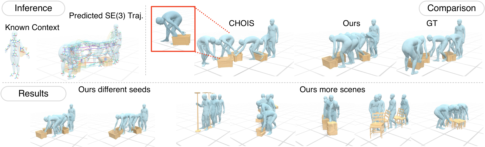
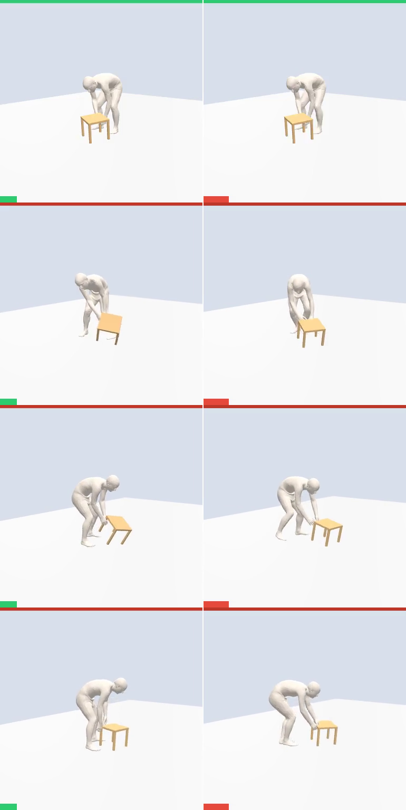
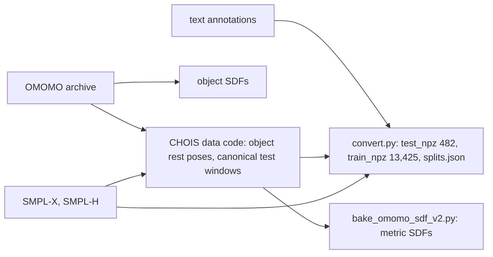
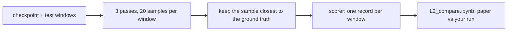

# OMOMO: human-object interaction synthesis



*Paper figure. Top left: what the model is given and what it predicts. Top right: CHOIS vs ours vs ground truth.
Bottom: more results from our model.*

## What the experiment is

The [OMOMO dataset](https://github.com/lijiaman/omomo_release) records people moving everyday objects (boxes,
chairs, tables, lamps, ...). The task follows CHOIS ([Li et al., ECCV 2024](https://arxiv.org/abs/2312.03913)):
given a text instruction, the human and the object at the first frame, and object waypoints (end position plus a
horizontal position every 30 frames), generate 120 frames of whole-body human motion **and** the object's motion.
The test set has 482 such windows from the two held-out subjects (sub16, sub17), 13 object types (vacuum and mop are
excluded, as in CHOIS).

How our model (WMM) is run for the table ("M7-strict" protocol, three passes of the same model, all with the text):

| Pass | Fixed to known values | Generated |
|---|---|---|
| 1 | human at frame 0; object at frames 0 and 119 (ground truth); object at frames 29/59/89 with the ground-truth horizontal waypoint, height interpolated between frames 0 and 119, rotation copied from frame 0 | everything else |
| 2 | human from pass 1; object at frame 0 (ground truth); object between keyframes from pass 1 | object at frames 29, 59, 89, 119 |
| 3 | the whole object trajectory from pass 2; human at frame 0 | human at frames 1..119 (final answer) |

For every window we draw 20 samples (seeds 0..19) and keep the one whose body joints are closest to the ground truth
("best of K=20", the convention of the OMOMO paper). Model outputs are converted back to SMPL-X body parameters before
scoring, so the same scorer can be used for every method.



*One test window (`sub17_smalltable_022`), frames 0, 39, 78, 117 top to bottom. Left: ground truth. Right: the paper
checkpoint's prediction. The green bar on the first row marks frame 0, where human and object are given; red marks
generated frames.*

## What the table measures

All lengths are in centimetres. ↓ = lower is better, ↑ = higher is better.

| Column | Plain meaning |
|---|---|
| T_s ↓ | How far the object's predicted position at the first frame is from the requested position |
| T_e ↓ | Same, at the last frame |
| T_xy ↓ | Same, horizontal distance only, at the in-between waypoints |
| H_feet ↓ | How high the feet float above (or sink below) the floor |
| FS ↓ | Foot sliding: how much a foot moves sideways while it should be planted |
| C_prec ↑ | Of the frames where the generated hand touches the object, how many also touch in the ground truth |
| C_rec ↑ | Of the frames where the ground-truth hand touches the object, how many the generated motion also touches |
| C_F1 ↑ | One number combining C_prec and C_rec (their harmonic mean) |
| C_% ↑ | Fraction of frames in which the generated hand touches the object |
| MPJPE ↓ | Average distance between generated and ground-truth body joints |
| T_root ↓ | Average distance between generated and ground-truth pelvis position |
| T_obj ↓ | Average distance between generated and ground-truth object position |
| O_obj ↓ | Average object rotation error (size of the difference between the two rotation matrices) |

The paper's WMM row:

| T_s | T_e | T_xy | H_feet | FS | C_prec | C_rec | C_F1 | C_% | MPJPE | T_root | T_obj | O_obj |
|---:|---:|---:|---:|---:|---:|---:|---:|---:|---:|---:|---:|---:|
| 0.15 | 6.48 | 4.40 | 0.84 | 0.56 | 0.79 | 0.67 | 0.76 | 0.59 | 12.07 | 19.87 | 16.53 | 1.03 |

| Rows | Source |
|---|---|
| InterDiff, MDM, Pred-OMOMO, CHOIS w/o L_obj, CHOIS w/o F_all, CHOIS | **Quoted** from CHOIS Table 1. |
| WMM (ours) | **Recomputed** from one record per test window (`metrics_raw.json`, 482 records). |

## Three layers of reproduction

| Layer | What you do | Needs | Time |
|---|---|---|---|
| L1 | Rebuild the table from the paper's per-window results | CPU, 1.3 MB of results | 1 minute |
| L2 | Run the paper checkpoint on the 482 test windows and score it | GPU (24 GB or more), licensed data you build | hours |
| L3 | Retrain the model from scratch | GPU (24 GB or more), licensed data you build | about 46 h on one RTX A6000 |

## Data

`release_data/` sits at the repository root (or set `WMM_DATA` to another folder). The OMOMO part has three sources.

**1. The WMM release folder** (download as described in the root README):

| Shard | Content | Layer |
|---|---|---|
| `results/omomo` | `omomo/L1_results/ours_wmm_w1.8.1.1_165k_M7nofuzzy/`: `metrics_raw.json` (per-window errors, the input of the table), `metrics.json` (the scorer's averages), `preds_meta.jsonl` (per-window sample seeds and the selected sample) | L1 |
| `checkpoints/omomo` | `omomo/checkpoints/w1.8.1.1_omomo_165k.ckpt`: the paper checkpoint (training step 164,000), model and EMA weights | L2 |
| `eval_data/omomo` | `omomo/L2_eval/data_wmm/omomo_v3/`: `artifacts/classifier/` (our text-motion classifier for FID and R_prec), `artifacts/glove_vocab/` (GloVe vectors of the 113 words of the annotations), `splits.json` (window names of both splits) | L2, L3 |

**2. Public third-party files**, fetched and checked by `prepare_data/download.sh` (pinned revisions, sha256):

| Item | Source | Licence |
|---|---|---|
| `omomo_text_anno.zip` (text instructions) | [lijiaman/omomo_release](https://github.com/lijiaman/omomo_release) @ `e9d8c52` | MIT (repository) |
| T5-base text encoder | [Hugging Face `t5-base`](https://huggingface.co/t5-base) @ `a9723ea` | Apache 2.0 |

**3. Licensed data you obtain yourself.** We do not redistribute SMPL-family data or anything derived from it.

| Item | Where | Put it at (under `release_data/omomo/`) |
|---|---|---|
| OMOMO dataset (`omomo_raw.tar.gz`, 21 GB; motion stored as SMPL-H parameters) | the dataset link in the [OMOMO README](https://github.com/lijiaman/omomo_release); `download.sh omomo` fetches it with `gdown` and checks its sha256 | `downloads/omomo_raw.tar.gz` |
| SMPL-X body model | [smpl-x.is.tue.mpg.de](https://smpl-x.is.tue.mpg.de) (register, accept the licence), "SMPL-X v1.1" npz files | `body_models/smplx/SMPLX_{MALE,FEMALE,NEUTRAL}.npz` |
| SMPL-H body model, AMASS version (16 shape parameters) | [mano.is.tue.mpg.de](https://mano.is.tue.mpg.de) (register), "Extended SMPL+H model" | `body_models/smplh_amass/{male,female,neutral}/model.npz` |

Then build every derived input (about 1.5 h, 30 GB of temporary space; GPU only for a few minutes):

```bash
conda env create -f apps/omomo/envs/umm.yml          # WMM, scorer and the converters
conda env create -f apps/omomo/envs/chois_repro.yml  # runs the vendored CHOIS data code
conda activate umm
apps/omomo/prepare_data/download.sh text t5 omomo
CHOIS_PYTHON=$(conda run -n chois_repro which python) apps/omomo/prepare_data/build_all.sh 0   # GPU 0
```



| Built file | Script | Shape / content |
|---|---|---|
| `L2_eval/data_wmm/omomo_v3/omomo_text_anno/{train,test}/` | `build_text_anno.py` | 4,354 + 558 json, `{seq_name: instruction}` |
| `L2_eval/data_wmm/omomo_v3/rest_object_geo/` | `build_chois_cache.py` (CHOIS `cano_traj_dataset.py`) | 13 objects: `.ply` mesh centred on its centre of mass, `.json` rest pose, `.npy` BPS `(1, 1024, 3)` |
| `L2_eval/classifier_data/chois_test_cache/`, `stats/` | `build_chois_cache.py` | CHOIS's canonical test windows (3,250) and joint statistics, read by the FID/R_prec classifier |
| `L2_eval/data_wmm/omomo_v3/rest_object_sdf/` | `build_rest_object_sdf.py` | OMOMO's 63 SDF files plus 34 copies under the names the scorer looks up; grids `(256, 256, 256)` float32 |
| `L2_eval/data_wmm/omomo_v3/rest_object_sdf_v2/` | `bake_omomo_sdf_v2.py` | 13 metric SDFs `(256, 256, 256)` float32, axes Z, Y, X, negative inside |
| `L2_eval/data_wmm/omomo_v3/test_npz/` | `code_train/prepare_data/omomo/convert.py --split test` | 482 windows; per window e.g. `Q (120, 22, 4, 4)`, `obj_rot (120, 3, 3)`, `obj_trans (120, 3)` float32 (all fields in the script's docstring) |
| `L3_train/data_wmm/omomo_v3/train_npz/` | `convert.py --split train` | 13,425 windows, same fields |
| `L2_eval/data_wmm/omomo_v3/splits.json` | `convert.py --write_splits` | window names of both splits |

## Layer 1: rebuild the table

```bash
# from the repository root; any Python >= 3.8 with pandas, matplotlib, nbconvert
jupyter nbconvert --to notebook --execute --inplace apps/omomo/L1_tables.ipynb
```

The notebook prints the full table.

## Layer 2: run the paper checkpoint



```bash
conda activate umm
apps/omomo/L2_eval.sh ours_smoke 0     # GPU 0: the first 9 test windows
apps/omomo/L2_eval.sh ours 0           # all 482 windows: inference, scoring (incl. FID, R_prec), 5 rendered videos
jupyter nbconvert --to notebook --execute --inplace apps/omomo/L2_compare.ipynb
```

Outputs go to `release_data/omomo/L2_outputs/<row>/`. `L2_compare.ipynb` prints the paper value and yours for every
column.

## Layer 3: retrain the model

The paper checkpoint is the `last.ckpt` of one training run of config `w1.8.1.1` at step 164,000.

| Item | Value |
|---|---|
| Training data | `L3_train/data_wmm/omomo_v3/train_npz/`: 13,425 windows of 120 frames (2.1 GB), plus the object, SMPL-X and text files of Layer 2 (linked by `build_all.sh`) |
| One training batch | `trace (16, 120, 23, 4, 4) float32`: 16 windows, 120 frames, 23 tracked parts (body parts and the object), each a 4x4 pose; `local_pcl (16, 23, 256, 6) float32`: 256 surface points with normals per part; `text`: 16 instructions |
| Model | 870 M parameters including an EMA copy and the frozen T5-base text encoder |
| Setting of the paper run | 1 RTX A6000, batch 16, no gradient accumulation (839 steps per epoch), 46.4 h to step 164,000, including an evaluation on 2% of the test windows every 10k steps |

```bash
conda activate umm
python apps/omomo/L3_smoke.py                  # CPU, about 1 minute: loads data, draws 3 batches, builds the model
wandb offline                                   # unless you log to your own Weights & Biases account
apps/omomo/L3_train.sh 0                       # one GPU; stops at step 164,000
apps/omomo/L3_probe.sh 0 release_data/omomo/L3_outputs/final/last.ckpt 164000   # Layer-2 evaluation, about 5.5 h
jupyter nbconvert --to notebook --execute --inplace apps/omomo/L2_compare.ipynb   # section "Layer 3"
```

The trainer saves every 2,000 steps but keeps only `last.ckpt` and the checkpoint with the lowest
`omomo_eval/MPJPE` (in `release_data/omomo/L3_outputs/w1.8.1.1_omomo/version_*/checkpoints/`); the paper used
`last.ckpt` at step 164,000. The trainer deletes `last.ckpt` a few seconds after the last step, so `L3_train.sh`
keeps a hard link to it as `L3_outputs/final/last.ckpt`. `L3_probe.sh <gpu> <file.ckpt> <name>` evaluates any
checkpoint like Layer 2 (copy intermediate checkpoints out of `checkpoints/` first: `last.ckpt` is rewritten every
2,000 steps).

## Code in this folder

| Path | Content |
|---|---|
| `code/` | Evaluation (Layer 2): model, three-pass sampling, scorer (`eval/omomo/`), FID/R_prec classifier code |
| `code_train/` | Training (Layer 3) and the window converter (`prepare_data/omomo/`) |
| `prepare_data/` | Downloads and builders of every input (see "Data") |
| `code/ext/baselines/chois_release/` | CHOIS code ([lijiaman/chois_release](https://github.com/lijiaman/chois_release) @ `8ec585a`, MIT licence in that folder); `build_chois_cache.py` runs its data code. `bps.pt` and `data/part_vert_ids/*.npy` are the upstream files unchanged. |
| `code*/ext/pytorch_kinematics/` | [pytorch_kinematics](https://github.com/UM-ARM-Lab/pytorch_kinematics) (MIT licence in that folder) |

## Troubleshooting

| Symptom | Cause and fix |
|---|---|
| `L3_train.sh` refuses more than one GPU | The paper setting is one GPU with batch 16. |
| First training step fails with `FileNotFoundError` on a `*.tmp.pid_*` file | A shared `torch.compile` cache; `L3_train.sh` uses a fresh cache folder per run (`WMM_COMPILE_CACHE` to choose one). |
| Contact columns are NaN | The scorer did not find `rest_object_geo/<object>.ply`; run `build_all.sh` and use `L2_eval.sh`, which links the data under `code/data/omomo/`. |
| `build_chois_cache.py`: SMPL-H model not found | Put the AMASS version of SMPL-H at `body_models/smplh_amass/{male,female,neutral}/model.npz`. |
