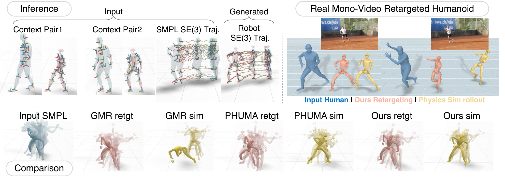
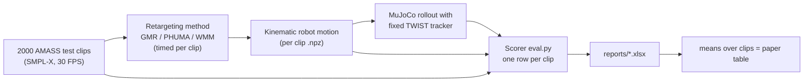
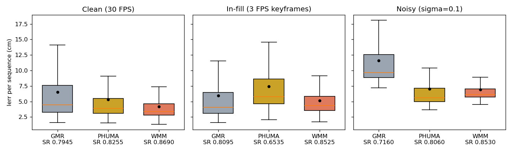
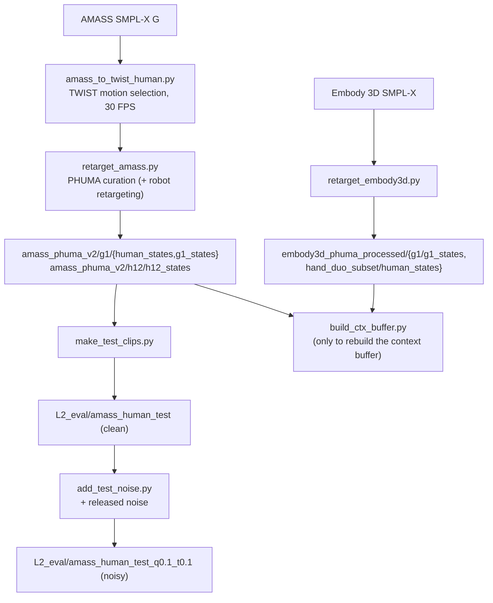

# Human-to-humanoid retargeting (paper Table "Humanoid Retargeting")



*Paper figure. Bottom row: one AMASS clip retargeted by GMR, PHUMA and WMM, each shown as the kinematic result
("retgt", red) and after the physics rollout ("sim", yellow). GMR's robot falls in simulation.*

## What the experiment is

A person's motion (SMPL-X body model, from the AMASS motion-capture dataset) must be turned into joint motion for
a Unitree G1 humanoid robot. This is called **retargeting**. A good retargeted motion looks like the human motion
*and* is physically feasible: when a fixed motion-tracking controller (TWIST's released policy
`twist_general_motion_tracker.pt`) follows it in the MuJoCo physics simulator, the robot should not fall and should
stay close to the target.

Three methods are compared on the same 2000 test clips (the first 2000 entries of
`amass_humanoid_v2_full_test.json`):

| # | Method | What it is |
|---:|---|---|
| 1 | GMR | General Motion Retargeting: fast inverse kinematics, run with the authors' released code |
| 2 | PHUMA | Per-clip physics-aware optimisation (3001 iterations per clip), run with the authors' released code |
| 3 | WMM | One trained WMM checkpoint (`w1.0.1`, step 38k) used for all three settings |

All rows were run with the same inputs, rollout and scorer; their per-clip results are released, so every number of
the table is recomputed here (Layer 1).

## The three input settings

| # | Setting | Human input given to the method |
|---:|---|---|
| 1 | Clean (30 FPS) | the full motion at 30 frames per second |
| 2 | In-fill (3 FPS keyframes) | only every 10th frame (plus the last). GMR and PHUMA retarget the keyframes and fill the gaps by linear interpolation; WMM fills them with its learned prior |
| 3 | Noisy (sigma = 0.1) | every frame corrupted with Gaussian noise, std 0.1 on the 165 SMPL-X axis-angle values (radians) and 0.1 m on the root position. The noise draw of the paper is released, so every user evaluates on the same noisy inputs |

## What each column measures

| # | Column | Plain meaning | Better |
|---:|---|---|---|
| 1 | FPS | retargeting speed: frames of robot motion produced per second of wall-clock compute, averaged over clips | higher |
| 2 | SR-seq | success rate: fraction of clips in which the simulated robot never falls | higher |
| 3 | gerr | global error: average distance (metres) between where each robot link should be (kinematic result) and where it is in simulation, in world coordinates | lower |
| 4 | lerr | local error: the same distance measured relative to the robot's pelvis, so drift of the whole body does not count | lower |

Details that matter when you compare numbers:

| # | Detail |
|---:|---|
| 1 | A frame counts as "fallen" once, for 5 frames in a row, the human is upright but the robot's pelvis is tilted more than 45° and lower than 0.2 m. From then on the clip is fallen. `gerr`/`lerr` average only the frames before the fall (standing frames), over 25 of the G1 links; read them together with SR-seq |
| 2 | Before measuring `gerr`, the simulated robot is shifted and turned (ground plane only) so its first-frame pelvis matches the kinematic result; all later drift counts |
| 3 | FPS is per clip `frames / seconds`, then averaged over clips |

## How the numbers are produced



| # | Layer | Starts from | Needs | Rough cost |
|---:|---|---|---|---|
| 1 | L1 | the released per-clip reports | CPU, 13 MB download | 1 min |
| 2 | L2 | the paper checkpoint and test clips you build | GPU (WMM), many CPU cores (rollout, baselines), AMASS + SMPL-X | see [Layer 2](#layer-2-recompute-every-row) |
| 3 | L3 | training data you build | one GPU, AMASS + Embody 3D + SMPL-X | see [Layer 3](#layer-3-retrain-the-wmm-checkpoint) |

All paths below are relative to the repository root; `release_data/` is where you put the downloads (or set
`WMM_DATA=/path/to/release_data`).

## Layer 1: the table from the released per-clip results

```bash
pip install numpy pandas openpyxl matplotlib nbconvert ipykernel
jupyter nbconvert --to notebook --execute --inplace apps/retargeting/L1_tables.ipynb
```

Data: `release_data/retargeting/L1_results/` (10 files, 13 MB) from the public data folder.

| # | File | Content |
|---:|---|---|
| 1 | `reports/<run>_mjc_rollout_report_2000.xlsx` (9 files) | one sheet, 2002 rows × 62 columns: rows `mean`, `std`, then clips `0…1999`. Columns used: `SR-seq` (0/1), `SR-succ_n` / `SR-total_n` (standing frames / all frames), `gerr`, `lerr` (m), `retgt_nframes`, `retgt_runtime` (s), `retgt_fps` |
| 2 | `splits/amass_humanoid_v2_full_test.json` | list of 2014 `[clip_id, …]` entries; row *i* of every report is clip `split[i][0]` |

Run names: `amass_gmr_inferred*` = GMR, `amass_phuma3001*` = PHUMA, `w1.0.1_v4_38k*` = WMM; suffix none = clean,
`_3fps` = in-fill, `_q0.1_t0.1` (`_ct10` for WMM) = noisy.

The notebook recomputes each cell from the per-clip rows and prints the table.

It also draws the spread of per-clip errors:



## Data you build yourself (licensed sources)

AMASS, SMPL-X and Embody 3D may not be redistributed, so the test clips, the training data and everything derived
from them are **not** in the download. You register with the providers, download their files, and build the exact
inputs with the scripts in `prepare_data/`.

| # | Source | Where to get it | Needed for |
|---:|---|---|---|
| 1 | SMPL-X body model (`SMPLX_NEUTRAL.npz`, v1.1) | <https://smpl-x.is.tue.mpg.de> | L2, L3 |
| 2 | AMASS, "SMPL-X G" archives of the 20 subsets listed in `prepare_data/amass_to_twist_human.py` | <https://amass.is.tue.mpg.de> | L2 (test clips), L3 |
| 3 | Embody 3D SMPL-X fits (`embody_3d__20251016__*_smplx.zip`, release form on the site) | <https://www.meta.com/emerging-tech/codec-avatars/embody-3d/>, tools at <https://github.com/facebookresearch/embody-3d> | L3 |

Place the SMPL-X files in `release_data/retargeting/L2_eval/smpls/smplx/` (the folder holding `SMPLX_NEUTRAL.npz`).



| # | Step | Command | Output | Rough cost |
|---:|---|---|---|---|
| 1 | Select the AMASS motions of the TWIST motion dataset and resample them to 30 FPS | `python apps/retargeting/prepare_data/amass_to_twist_human.py --amass_root <amass> --out <amass_twist>` | `<amass_twist>/human_states/` (8,234 motions) | minutes |
| 2a | L2 only: PHUMA curation of the test motions, human chunks only | `python apps/retargeting/prepare_data/retarget_amass.py --human_only --src_root <amass_twist>/human_states --split release_data/retargeting/L1_results/splits/amass_humanoid_v2_full_test.json --save_root release_data/retargeting/L3_train/data/amass_phuma_v2/g1` | `…/g1/human_states/` for 1,857 motions | about 16 CPU-core seconds per motion |
| 2b | L3: curation and retargeting to G1 and H1-2 of all motions | `retarget_amass.py --src_root <amass_twist>/human_states --save_root release_data/retargeting/L3_train/data/amass_phuma_v2/g1 --robot_name g1`, then the same with `…/h12 --robot_name h1_2` | `g1/{human_states,g1_states}` (10,065 / 7,672 files), `h12/h12_states` (7,672) | about 6 CPU-core minutes per motion and robot |
| 3 | Clean test clips | `python apps/retargeting/prepare_data/make_test_clips.py --human_states release_data/retargeting/L3_train/data/amass_phuma_v2/g1/human_states --split release_data/retargeting/L1_results/splits/amass_humanoid_v2_full_test.json --out release_data/retargeting/L2_eval/amass_human_test` | 2014 clips | seconds |
| 4 | Noisy test clips: clean clips + the paper's noise draw | `python apps/retargeting/prepare_data/add_test_noise.py --clean release_data/retargeting/L2_eval/amass_human_test --noise release_data/retargeting/L2_eval/amass_human_test_q0.1_t0.1_noise --out release_data/retargeting/L2_eval/amass_human_test_q0.1_t0.1` | 2014 clips | 1 min |
| 5 | Embody 3D curation and retargeting to G1 | `python apps/retargeting/prepare_data/retarget_embody3d.py --embody3d_root <embody3d> --save_root release_data/retargeting/L3_train/data/embody3d_phuma_processed/g1`, then `--indices apps/retargeting/prepare_data/embody3d_indices_hand_duo.json --save_root …/embody3d_phuma_processed/hand_duo_subset` | `g1/g1_states` (78,767 files), `hand_duo_subset/human_states` (3,317) | about 10 CPU-core minutes per person (26,258 + 299 persons) |

Notes on the scripts:

| # | Note |
|---:|---|
| 1 | Steps 2 and 5 run PHUMA from `release_data/retargeting/code_ext/baselines/` in the `phuma` environment (`apps/retargeting/envs/phuma.yml`), one single-threaded worker per CPU core (`--workers`, default: all cores but two). A chunk's result does not depend on the number of workers. `--resume` skips chunks already retargeted |
| 2 | PHUMA's curation rejects a few motions; they are listed in `<save_root>/failed.txt` |
| 3 | `twist_motion_index.json` lists the names and frame counts of the TWIST motion dataset (<https://github.com/YanjieZe/TWIST>); `embody3d_indices*.json` list the Embody 3D captures and persons used for training |

## Layer 2: recompute every row

Each method retargets the 2014 test clips, MuJoCo plays every result with the TWIST tracker, and the scorer writes a
fresh report. `L2_compare.ipynb` rebuilds the table from your reports and prints it next to the paper values.

### Download

| # | Item | Where it goes | Size |
|---:|---|---|---:|
| 1 | WMM paper checkpoint (model + EMA weights and the context buffer recorded during training) | `release_data/retargeting/checkpoints/w1.0.1_v4_38k_ctx.ckpt` | 3.5 GB |
| 2 | Noise of the paper's noisy test set (`pose_noise` (1, T, 165), `global_t_noise` (1, T, 3), float64 per clip) | `release_data/retargeting/L2_eval/amass_human_test_q0.1_t0.1_noise/` | 0.8 GB |
| 3 | Robot meshes used by the WMM config | `release_data/retargeting/L2_eval/amass_phuma/`, `L2_eval/amass_phuma_v2/g1/robot_meshes.npz` | 8 MB |
| 4 | Robot assets and kinematics (`lib_twist`, `pytorch_kinematics`) and the GMR/PHUMA code as used for the paper | `release_data/retargeting/code_ext/` | 0.35 GB |
| 5 | TWIST tracker policy, from the TWIST repository (sha256 checked) | `apps/retargeting/prepare_data/download_third_party.sh` | 1 MB |

Then build the test clips (steps 1, 2a, 3, 4 above). Conda environments:
`apps/retargeting/envs/umm.yml` (WMM, rollout, scoring), `gmr.yml` (GMR), `phuma.yml` (PHUMA and data preparation).
The scripts put the released code on `PYTHONPATH` themselves.

### The context buffer

At inference WMM conditions on context frames: paired human/robot poses recorded from training batches
(`ctx_record_buffer`, one queue of 16,384 frames per set of body parts, each frame (1, P, 4, 4) float32). The
released checkpoint contains the buffer recorded during the paper's training, so Layer 2 needs no training data.
To rebuild the buffer from your own training data (steps 2b and 5) with the training data loader and a fixed seed:

```bash
python apps/retargeting/prepare_data/build_ctx_buffer.py \
    release_data/retargeting/checkpoints/w1.0.1_v4_38k_ctx.ckpt \
    release_data/retargeting/checkpoints/w1.0.1_v4_38k_rebuilt_ctx.ckpt
```

### Run

```bash
export PYTHON=<umm env>/bin/python PYTHON_GMR=<gmr env>/bin/python PYTHON_PHUMA=<phuma env>/bin/python
CUDA_VISIBLE_DEVICES=0 apps/retargeting/L2_eval.sh wmm_clean       # also wmm_infill, wmm_noisy
apps/retargeting/L2_eval.sh gmr_clean                              # also gmr_infill, gmr_noisy
apps/retargeting/L2_eval.sh phuma_clean                            # also phuma_infill, phuma_noisy
jupyter nbconvert --to notebook --execute --inplace apps/retargeting/L2_compare.ipynb
```

Each call runs three stages (`infer`, `rollout`, `score`; pass one as the second argument to run only it) and writes
to `release_data/retargeting/L2_outputs/`: `<run>/` (robot motion per clip), `<run>_mjc_rollout/` (simulated motion
per clip), `reports/<run>_mjc_rollout_report_2000.xlsx`. `N_FIRST=20` scores only the first 20 clips, a quick check
of the whole pipeline. A row can be split over several GPUs or CPU sets with `SPLIT_RANGE=start:end` (run `infer` once
per range of test-split entries, e.g. `0:1007` and `1007:2014`, then `rollout` and `score` once). GMR and PHUMA use 8
and 4 pinned CPU cores per worker; restrict them with `taskset -c`. All options are listed at the top of
`L2_eval.sh`.

`L2_compare.ipynb` prints each cell of your run next to the paper value.

## Layer 3: retrain the WMM checkpoint

### The paper run

| # | Fact | Value |
|---:|---|---|
| 1 | Command | `python train.py --config configs/wmm/hh/w1.0.1.yaml --workers 12 --viz_try` |
| 2 | GPUs | **one GPU** (RTX A6000), batch 8 |
| 3 | Main settings | 16-bit precision, seed 42, learning rate 5e-5 (betas 0.9/0.999, weight decay 1e-3, 100 warm-up steps, decay to 1e-6 over 300k steps), EMA weights, diffusion with 100 training steps, data mix Embody 3D : AMASS = 1 : 4 (`configs/wmm/hh/w1.0.1.yaml`) |
| 4 | Paper checkpoint | step 38,000 |
| 5 | Time to step 38,000 | about 19 h on one RTX A6000, of which about 11 h were the in-training retargeting checks at steps 10k, 20k and 30k; about 8 h without them |

The in-training check (`callbacks.hh_eval`) retargets 10 test clips every 10,000 steps, plays them in MuJoCo and
renders videos on the CPU. It also hands the context buffer recorded during training to the EMA model, whose weights
inference loads.
Disable it to train in about 8 h: `apps/retargeting/L3_train.sh 0 --callbacks.hh_eval.enabled=False` (the
`key=value` form is required); `L3_train.sh` then gives the EMA model the recorded buffer itself
(`L3_share_ctx_buffer.py`, weights untouched) when it writes `ckpt_keep/for_inference.ckpt`.

### Data and code

| # | Item | Where | Size |
|---:|---|---|---:|
| 1 | Motion states built by steps 2b and 5: Embody 3D `g1/g1_states`, `hand_duo_subset/human_states`; AMASS `g1/g1_states`, `g1/human_states`, `h12/h12_states`; plus each folder's `robot_meshes.npz` | `release_data/retargeting/L3_train/data/` | 37 GB |
| 2 | Training splits (download): Embody 3D `full_train.json` (69,626 windows), AMASS `full_train.json` (7,045 windows), the two `debug_val.json`; and links to SMPL-X, `code_ext/ext`, the robot meshes and the clean test clips | `release_data/retargeting/L3_train/{data_splits,ext,data/smpls,data/amass_phuma,logs}` | 12 MB |
| 3 | Training code: `train.py`, `src/umm`, the config and the modules training imports | `apps/retargeting/code/train/` | 3 MB |

### Run

```bash
$PYTHON apps/retargeting/L3_smoke.py                     # CPU check: 3 batches + model, ~1 min
PYTHON=$PYTHON apps/retargeting/L3_train.sh 0            # one GPU, as in the paper run
```

`L3_train.sh` stops at step 38,000 (`MAX_STEPS`), writes logs and checkpoints to
`release_data/retargeting/L3_outputs/`, keeps Weights & Biases offline, and finally writes
`version_0/ckpt_keep/for_inference.ckpt`. Score it with
`WMM_CKPT=<…>/version_0/ckpt_keep/for_inference.ckpt WMM_TAG=_l3 apps/retargeting/L2_eval.sh wmm_clean` (and
`wmm_infill`, `wmm_noisy`); `L2_compare.ipynb` shows the scores in its `L3` column.

## Troubleshooting

| # | Message or symptom | Cause and fix |
|---:|---|---|
| 1 | `ctx_record_buffer is empty` | the checkpoint has no context buffer: use the released `w1.0.1_v4_38k_ctx.ckpt`, or run `L3_share_ctx_buffer.py` on your own run |
| 2 | `ctx_record_buffer has no entry for uid-tuple` | the buffer was built from data without paired human/G1 windows; build it from the full training data (steps 2b and 5) |
| 3 | `missing …/amass_human_test` or `…/smpls/smplx` | build the test clips (steps 1–4) and place SMPL-X as described above |
| 4 | Segmentation fault on a machine without a visible GPU | SAPIEN (imported by the code) needs CPU rendering: `L2_eval.sh` and the scripts set `SAPIEN_RENDER_DEVICE=cpu`; set it yourself when you call the Python code directly |
| 5 | `L3_train.sh` crashes in validation after resuming or with other jobs running | each run uses a private compile cache (`TORCHINDUCTOR_CACHE_DIR`, set by `L3_train.sh`); do not point two runs at the same cache |
| 6 | Training uses more than one GPU | the trainer uses every visible GPU and the global batch grows with it; give `L3_train.sh` one GPU id to match the paper |

## Files

| # | Path | Role |
|---:|---|---|
| 1 | `L1_tables.ipynb`, `l1_retargeting.py` | Layer 1 |
| 2 | `L2_eval.sh`, `L2_compare.ipynb` | Layer 2 |
| 3 | `L3_smoke.py`, `L3_train.sh`, `L3_share_ctx_buffer.py` | Layer 3 |
| 4 | `prepare_data/` | builds every licensed-data-derived input; downloads third-party files |
| 5 | `export_weights.py` | writes a weights-only checkpoint (model + EMA tensors) from a full training checkpoint |
| 6 | `code/` | WMM evaluation code (`src`, `eval`) and training code (`train/`) |
| 7 | `code_baselines/` | GMR and PHUMA driver scripts |
| 8 | `envs/` | conda environments |
