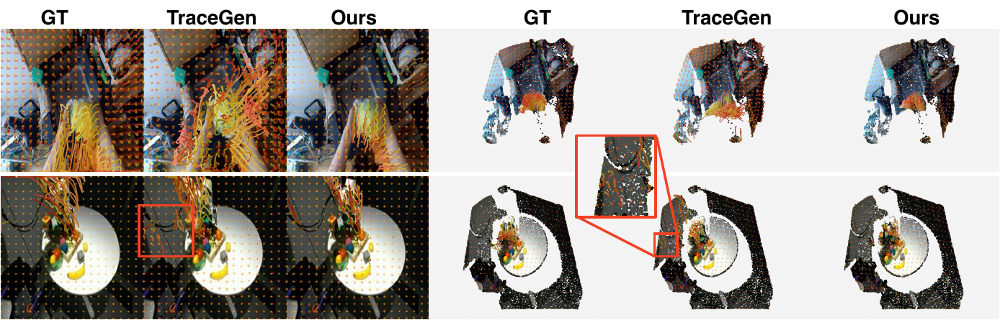
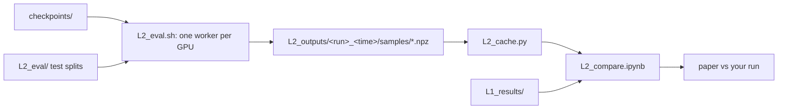

# TraceGen: predicting how 400 points in a scene will move



*Paper figure. Each colored curve is one keypoint's predicted path. Columns: ground truth, TraceGen, ours. Left: paths
drawn on the start image; right: the same paths in 3D on the depth point cloud. The red box marks paths TraceGen gets
wrong.*

## What the experiment is

[TraceGen](https://arxiv.org/abs/2511.21690) (Lee et al.) is a benchmark. Each test sample gives a model

- one start image (with depth) of a robot or kitchen scene,
- a language instruction such as "Put the blue toy in the green bowl",
- 400 keypoints on the image,

and asks the model to predict where each of the 400 keypoints will be in 3D over the next 32 time steps.
We use the two subsets that have 3D ground truth: **Droid** (robot arm videos, 10,816 test samples) and
**EpicKitchen** (human kitchen videos, 7,928 test samples).

Our model (WMM) treats every keypoint as one entity and predicts its trajectory. The paper reports six checkpoints:
trained on Droid only, on EpicKitchen only, or jointly on both ("Joint"), each with P = 128 or P = 400
keypoints seen per training example. The Joint checkpoints are tested on both datasets.

## What the table measures

All numbers are multiplied by 100; lower is better. Positions are x, y in image coordinates scaled to [0, 1] and z = depth.

| Metric | Plain meaning |
|---|---|
| MSE | Average of (predicted − true)² over every valid coordinate of every point at every time step |
| MAE | Average of \|predicted − true\| over the same coordinates |
| Endp. (endpoint MSE) | Squared error of each point's **last** valid position only, averaged |

Only test samples that pass the TraceGen authors' filter are counted: more than 3 valid frames, at least one
point that moves, at least one point with ground truth. That leaves 8,421 Droid and 7,119 EpicKitchen samples.

The paper table (×100):

```text
                     Dr MSE  Dr MAE  Dr Endp.  Ep MSE  Ep MAE  Ep Endp.
TraceGen (quoted)    0.206   1.289   0.285     0.445   2.721   0.791
per-dataset (P=128)  0.151   1.129   0.200     0.322   2.130   0.556
per-dataset (P=400)  0.178   1.169   0.236     0.329   2.167   0.580
Joint (P=128)        0.167   1.172   0.225     0.346   2.256   0.615
Joint (P=400)        0.187   1.179   0.259     0.351   2.287   0.621
```

## Data you need

All data lives under `release_data/tracegen/` at the repository root (or under `$WMM_DATA/tracegen/` if you set
`WMM_DATA`). Files from the public Google Drive folder (link in the root README) are `.tar` shards; unpack each one with
`tar -xf <shard>.tar -C release_data/tracegen`.

| Layer | Folder | Size | How to get it |
|---|---|---|---|
| 1 | `L1_results/` | 4.6 GB, 122 files | Drive `results/tracegen/` |
| 2, 3 | `checkpoints/w1.6.0_*/` | 6 × 5.5 GB | Drive `checkpoints/tracegen/` (the six paper checkpoints) |
| 2, 3 | `checkpoints/hf_home/`, `checkpoints/tracegen_authors/`, `checkpoints/dinov3/` | 1.3 + 6.6 + 0.09 GB | `python apps/tracegen/prepare_data/download_weights.py --dinov3-url <URL>` |
| 2 | `L2_eval/data_wmm/tracegen/data/{Droid/droid_test,Epickitchen/epic_test}` | 17.4 + 12.4 GB | `python apps/tracegen/prepare_data/download_data.py --splits droid_test epic_test` |
| 3 | `L3_train/data_wmm/tracegen/data/{Droid/droid,Epickitchen/epic_1,2,3}` | 314 + 188 GB | `python apps/tracegen/prepare_data/download_data.py` |
| 3 | `L3_train/data_wmm/tracegen_localframes/` | 26.4 GB | Drive `train_data/tracegen/`, or build it (below) |

**Third-party data and licences.**

| What | Source | Licence |
|---|---|---|
| TraceGen Droid splits | Hugging Face `yoonkyojung/TraceGenDroid`, revision `c35bc523` | CC BY 4.0 (derived from DROID) |
| TraceGen EpicKitchen splits | Hugging Face `yoonkyojung/TraceGenEpickitchen`, revision `234a97a6` | CC BY-NC 4.0 (derived from EPIC-KITCHENS; non-commercial use only) |
| TraceGen authors' checkpoints | Hugging Face `JayLee131/TraceGen_Droid`, `JayLee131/TraceGen_EpicKitchen` | Apache-2.0 |
| T5 text encoder | Hugging Face `t5-base` | Apache-2.0 |
| SigLIP image encoder (TraceGen baseline) | Hugging Face `google/siglip-base-patch16-384` | Apache-2.0 |
| DINOv3 ViT-L (TraceGen baseline) | Hugging Face `timm/vit_large_patch16_dinov3.lvd1689m` | DINOv3 License |
| DINOv3 ViT-S/16 image encoder (WMM) | Meta, [DINOv3 downloads](https://ai.meta.com/resources/models-and-libraries/dinov3-downloads/) | DINOv3 License; accept it to receive the download URL by e-mail |

Both download scripts are pinned to one revision per source and check the SHA-256 of every file; they stop on any
mismatch. `download_data.py` also checks the number of episodes and files of every split and links the two test splits
into `L3_train/` (the training configs read them there). It downloads one shard at a time (17 GB at most) and deletes it
after unpacking unless you pass `--keep-tars`.

**Local frames.** `tracegen_localframes/` holds a per-keypoint rotation for every training sample (a local SE(3) frame
fitted to each keypoint's 8 nearest neighbours by Procrustes). The Drive copy is the one the paper runs used. To build
it yourself (CPU only; about 75 samples per second with 16 processes, so roughly 1–2 hours for all splits):

```bash
cd release_data/tracegen/L3_train
python ../../../apps/tracegen/prepare_data/compute_local_frames.py \
    --src-root data_wmm/tracegen/data --out-root data_wmm/tracegen_localframes --workers 16
```

Samples with fewer than 5 valid frames get no file and train with an identity rotation.

## Layer 1: the table from the paper's predictions (no GPU)

```bash
pip install numpy pandas matplotlib nbconvert nbformat ipykernel
jupyter nbconvert --to notebook --execute --inplace apps/tracegen/L1_tables.ipynb
```

It prints the table. Check the download first if you like:
`cd release_data/tracegen/L1_results && sha256sum -c SHA256SUMS`.

```text
release_data/tracegen/L1_results/
  gt/<env>/samples.csv        one row per test sample: episode, instruction, filter flag
  gt/<env>/chunk_NNN.npz      1024 samples per chunk (last chunk shorter)
  runs/<run>/chunk_NNN.npz    predictions of one checkpoint on <env>, same chunking
  runs/<run>/metrics.json     numbers written by the original evaluation
  runs/<run>/{rollout,inference}_config.json   evaluation settings
```

`<env>` is `droid` or `epic`. Arrays (n = samples in the chunk):

| File | Array | Shape | dtype |
|---|---|---|---|
| gt chunk | `sample_index` | (n,) | int64 |
| gt chunk | `gt_trace_abs` | (n, 33, 400, 3) | float32 |
| gt chunk | `trace_valid_mask_per_coord` | (n, 33, 400, 3) | bool |
| gt chunk | `valid_steps` | (n,) | int64 |
| gt chunk | `movement_bool`, `gt_mask` | (n, 400) | bool |
| gt chunk | `kept_by_filter` | (n,) | bool |
| run chunk | `sample_index` | (n,) | int64 |
| run chunk | `pred_trace_abs` | (n, 33, 400, 3) | float32 |

Axis order is (sample, time step, keypoint, xyz). `tg_l1.py` holds the metric code. The table rows map to these runs:

| Table row | Droid run | EpicKitchen run |
|---|---|---|
| per-dataset (P=128) | `w1.6.0_droid_k128_v9_50k_droid_…` | `w1.6.0_epic_k128_v10_30k_epic_…` |
| per-dataset (P=400) | `w1.6.0_droid_k400_v4_80k_droid_…` | `w1.6.0_epic_k400_v9_60k_epic_…` |
| Joint (P=128) | `w1.6.0_droidepic_k128_v9_45k_droid_…` | `w1.6.0_droidepic_k128_v9_45k_epic_…` |
| Joint (P=400) | `w1.6.0_droidepic_k400_v10_68k_droid_…` | `w1.6.0_droidepic_k400_v10_68k_epic_…` |

## Layer 2: run the paper checkpoints again (GPU)

Layer 2 runs the six paper checkpoints on the full test splits and rebuilds the table from your predictions. It needs
an NVIDIA GPU with 24 GB or more.



Environment: conda env from `env/umm_environment.yml` (Python 3.10, PyTorch 2.3.1, CUDA 11.8) for our model,
`env/trace_gen_environment.yml` (PyTorch 2.4.1, CUDA 12.4) for the TraceGen baseline.

```bash
conda env create -f apps/tracegen/env/umm_environment.yml
conda env create -f apps/tracegen/env/trace_gen_environment.yml
export WMM_PYTHON=$(conda run -n umm which python) TRACEGEN_PYTHON=$(conda run -n trace_gen which python)
# quick check (a few minutes): 0.3% of each test split, all eight table cells, one GPU
EVAL_EFFORT=0.003 bash apps/tracegen/L2_eval.sh 0
rm -r release_data/tracegen/L2_outputs     # remove the quick-check outputs before the full run
# full run: one worker per free GPU; each worker takes the next row that nobody has started
bash apps/tracegen/L2_eval.sh 0 > worker0.log 2>&1 &
bash apps/tracegen/L2_eval.sh 1 > worker1.log 2>&1 &
# TraceGen authors' checkpoint with the authors' own evaluation code
bash apps/tracegen/L2_eval_baseline.sh 2 droid
bash apps/tracegen/L2_eval_baseline.sh 3 epickitchen
# when the runs have finished: summarize each run's sample files once (a few minutes per run), then compare (seconds)
(cd apps/tracegen && python L2_cache.py)
jupyter nbconvert --to notebook --execute --inplace apps/tracegen/L2_compare.ipynb
```

A worker claims a row by creating `L2_outputs/.claims/<run>/`; delete that folder to run a failed row again. Each run
writes about 34 GB (Droid) or 25 GB (EpicKitchen): one `.npz` per sample plus a copy of the checkpoint. Every run also
renders its first two kept samples (`debug_renders/*.mp4`): ground truth and prediction drawn over the start image and
on the depth point cloud.

The checkpoints hold only the weights (`state_dict` with the training model and its EMA copy, the EMA state,
`epoch`, `global_step`); evaluation uses the EMA weights.

| Code | Origin |
|---|---|
| `code/` | The evaluation code of the paper runs, reduced to the Python files the evaluation imports, including the DINOv3 model code in `ext/dinov3/`. `src/umm/models/wmm/dino_encoder.py` reads the DINOv3 code and weight folders from `WMM_DINOV3_REPO` / `WMM_DINOV3_CKPT_DIR` (the scripts set both). |
| `baseline/TraceGen/` | TraceGen authors' code, upstream commit `728621eb` (Apache-2.0); two unused images removed. |

## Layer 3: train the models again (GPU)

| # | Step | Command | Hardware | Cost |
|---:|---|---|---|---|
| 1 | Check that code, config and data load and the model builds (no training) | `python apps/tracegen/L3_smoke.py --run droidepic_k128` | CPU | minutes |
| 2 | Train one row to the step of its paper checkpoint | `bash apps/tracegen/L3_train.sh <run> <gpu>` | 1 GPU with 48 GB | see the table below |
| 3 | Evaluate the trained checkpoint on a full test split (refuses a checkpoint that is not at the paper step) | `bash apps/tracegen/L3_eval.sh <gpu> <run> <droid\|epic>`; to split it over N GPUs add `<shard> <N> <stamp>` (script header) | 1 GPU (or N) | hours |
| 4 | Compare your checkpoints with the paper | `(cd apps/tracegen && python L2_cache.py)`, then `jupyter nbconvert --to notebook --execute --inplace apps/tracegen/L3_compare.ipynb` | CPU | a few minutes per finished evaluation, then seconds |

| `<run>` | Table row | Step | Wall time of the paper run to that step (1 A6000, including in-training evaluation) |
|---|---|---:|---:|
| `droid_k128` | per-dataset P=128, Droid | 50,000 | about 21 h |
| `epic_k128` | per-dataset P=128, EpicKitchen | 30,000 | about 12 h |
| `droid_k400` | per-dataset P=400, Droid | 80,000 | about 21 h |
| `epic_k400` | per-dataset P=400, EpicKitchen | 60,000 | about 16 h |
| `droidepic_k128` | Joint P=128 (both columns) | 46,000 | about 21 h |
| `droidepic_k400` | Joint P=400 (both columns) | 68,000 | about 20 h |

All six together cost about 110 GPU-hours. `L3_train.sh` runs `code_train/train.py` with the training configs
(`code_train/configs/wmm/tg/w1.6.0_<run>_tpsqspt.yaml`) and `--workers 12`: batch 12 (P=128) or 4 (P=400) per GPU,
AdamW with learning rate 5e-5 decaying to 1e-6 over 300,000 steps after 500 warm-up steps, weight decay 1e-3, gradient
clipping 4.0, 16-bit mixed precision, `torch.compile` on, EMA of the weights, seed 42, a checkpoint every 2,000 steps.
The joint runs sample Droid and EpicKitchen 50/50. Because the learning-rate schedule is defined over 300,000 steps,
stopping at the paper step (`MAX_STEPS`) follows the paper run's schedule up to that point. Each paper run trained on
one GPU; listing several GPUs trains data-parallel and multiplies the global batch. Checkpoints and logs go to
`release_data/tracegen/L3_outputs/<RUN_NAME>/version_<N>/` (default `RUN_NAME` `w1.6.0_<run>_L3`); Weights & Biases
logs stay offline. The data loader holds out 1% of training episodes as validation (seed 42): Droid 8,916 / 90
episodes (193,346 / 1,954 samples), EpicKitchen 9,726 / 98 episodes (119,021 / 1,063 samples).

To continue a stopped run, pass the absolute path of its newest `last*.ckpt` (`last.ckpt`; after one resume the
trainer writes `last-v1.ckpt` instead):
`bash apps/tracegen/L3_train.sh droid_k128 0 --resume "$PWD/release_data/tracegen/L3_outputs/w1.6.0_droid_k128_L3/version_0/checkpoints/last.ckpt"`
(a bare version number such as `--resume 0` makes `train.py` look under `./logs` and start from step 0).

**Which checkpoint to evaluate.** Training stops at `MAX_STEPS`, the step of the paper checkpoint. The trainer rewrites
`checkpoints/last.ckpt` every 2,000 steps and deletes it when the run ends, so `L3_train.sh` keeps a hard link to it,
`ckpt_keep/last_link.ckpt`, which after the run holds exactly that step; `L3_eval.sh` evaluates it and checks the step.
`epoch=…_step=…ckpt` in `checkpoints/` is a second checkpoint the trainer keeps; it can be an earlier step.

**Optional speed-ups.** The in-training TraceGen evaluation (every 10,000 steps) only reports
numbers and does not change the weights, but it costs 40–50 min each time; two visualization callbacks render videos
every 500 steps. To switch them off, append to the `L3_train.sh` command:
`--tg_eval.eval_every_n_steps=-1 --ckpt_monitor val_LOSS/total --viz_every_n_train_steps=-1` (Joint P=128 also
`--tg_eval_aux.eval_every_n_steps=-1`; the P=128 configs also `--tg128_sliding_viz.viz_every_n_train_steps=1000000000`,
which refuses values ≤ 0).

**Training code.** `code_train/` is the code snapshot saved by the paper runs themselves, reduced to the modules
training imports and the files in the same folders; `ext/dinov3/` is the DINOv3 model code and `ext/lib_io/` holds the
`UnifiedIO` reader the dataset modules import. `dino_encoder.py` reads the DINOv3 folders from `WMM_DINOV3_REPO` /
`WMM_DINOV3_CKPT_DIR`, as in Layer 2.

## Baseline row

The TraceGen row is quoted from the TraceGen paper (Table 1).
